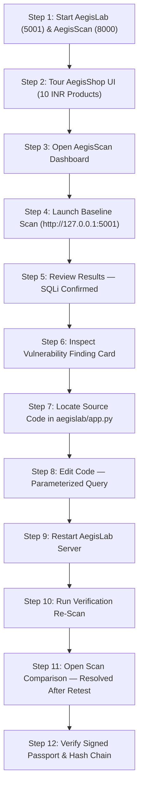

# AEGISSCAN 2.0 & AEGISSHOP — FINAL WEB SECURITY & REMEDIATION DEMO GUIDE
## Complete Step-by-Step Presentation Script for College Evaluation

---

### Project Overview
- **Project Root:** `D:\PRJ4`
- **Scanner Application:** AegisScan 2.0 (`http://127.0.0.1:8000`)
- **Target Application:** AegisShop E-Commerce Store (`http://127.0.0.1:5001`)
- **Key Capability Demonstrated:** Live Web Vulnerability Remediation (SQL Injection Detection &rarr; Source-Code Fix &rarr; Differential Rescan &rarr; Cryptographic Verification)
- **Target Audience:** Academic Evaluators, External Examiners, Computer Science Faculty
- **Estimated Presentation Time:** 5 &ndash; 7 Minutes

---

## 1. Architecture & Security Model Overview

AegisScan 2.0 is a dual-capability application security testing and verification platform:

1. **Web Application Vulnerability Engine:**
   - Autonomous crawling, form discovery, and parameter extraction.
   - Active vulnerability detectors: **SQL Injection (SQLi)**, **Reflected Cross-Site Scripting (XSS)**, and **Insecure Direct Object Reference (IDOR)**.
   - Passive security controls: HTTP Security Headers, Insecure Cookies, TLS Certificate validation, and technology discovery.
   - **Control-Request Validation Layer:** Before any vulnerability is classified as "Confirmed", AegisScan fires baseline control requests (`testvalue123`) to prove differential behavior and eliminate false positives on decoy/mock endpoints.

2. **Controlled AI-Agent Security Benchmark:**
   - Evaluates LLM assistants against indirect prompt injections, tool description poisoning, tool metadata rug-pulls, and unauthorized tool invocations (excessive agency).

3. **Cryptographic Provenance & Hash-Chained Audit Trail:**
   - Every scan produces an **Ed25519-signed Security Passport** ($Passport = \text{Sign}_{sk}(\text{SHA256}(R))$).
   - Each scan is immutably linked into a SHA-256 linear hash chain ($H_n = \text{SHA256}(R_n \parallel H_{n-1})$), guaranteeing historical tamper-evidence.

---

## 2. Priority Access Control & Authorization Architecture

### How AegisScan Governs Targets & Authorization
In enterprise environments, scanning arbitrary web infrastructure is strictly regulated. AegisScan implements a four-tiered authorization model:

1. **Strict ScopeGuard Anti-SSRF Protection:**
   - Local scanning is strictly bounded to `127.0.0.1` and `localhost`.
   - Private IP blocks (`10.0.0.0/8`, `172.16.0.0/12`, `192.168.0.0/16`, `169.254.0.0/16`), loopback (`127.0.0.0/8`), link-local, and IPv6 NAT64 reserved prefixes (`64:ff9b::/96`) are blocked by `ScopeGuard` to prevent Server-Side Request Forgery (SSRF) and intranet port-scanning.

2. **External Basic (Passive) Scanning:**
   - Bounded to non-intrusive passive checks (TLS, headers, robots.txt, HTML inventory).
   - Requires an explicit, self-attested legal authorization declaration (`AuthorizationGrant`) certifying ownership or permission.
   - Hard capped at **50 HTTP requests** and rate-limited to **2.0 requests/sec**.

3. **External Deep (Active) Scanning:**
   - Requires cryptographically verifiable technical domain ownership via a DNS or HTTP challenge token at `/.well-known/aegisscan-verification.txt`.
   - Never permitted against third-party or unverified domains.

4. **Academic Prototype Access Boundary:**
   - In this academic prototype, AegisScan operates as a **local single-operator assessment workbench** bound to `127.0.0.1:8000`.
   - All scan activities are attributed to the operator in an immutable SQLite `AuditEvent` table.
   - In an enterprise multi-tenant cloud deployment, this workbench would sit behind an API Gateway enforcing OAuth2/OIDC SSO and Role-Based Access Control (RBAC).

---

## 3. The 12-Step Live Demonstration Flow



---

### Step 1: Start Applications in Two Terminals

Open two separate Command Prompt or PowerShell windows:

#### Terminal 1 — AegisLab (Target E-Commerce Store):
```powershell
cd D:\PRJ4\aegislab
.\venv\Scripts\python.exe app.py
```
*Expected Terminal Output:*
```
[AegisLab] SECURE_MODE=OFF -- /login is vulnerable to SQLi (default)
 * Running on http://127.0.0.1:5001
```

#### Terminal 2 — AegisScan (Security Scanner & Workbench):
```powershell
cd D:\PRJ4
.\aegisscan\venv\Scripts\python.exe -m uvicorn aegisscan.main:app --host 127.0.0.1 --port 8000
```
*Expected Terminal Output:*
```
INFO:     Started server process
INFO:     Uvicorn running on http://127.0.0.1:8000 (Press CTRL+C to quit)
```

> 🎤 **What to Say:**
> *"Good morning professors and evaluators. Today we are demonstrating AegisScan 2.0, an automated web vulnerability assessment and AI security verification platform. On the left terminal, we have launched AegisShop, a mock e-commerce web application running locally on port 5001. On the right terminal, we have launched AegisScan, our security scanner running on port 8000."*

---

### Step 2: Showcase AegisShop Storefront

Open your web browser and navigate to:
```
http://127.0.0.1:5001
```

**Walkthrough Highlights:**
1. Point out the clean top navigation bar: **Home**, **Products**, **Search**, **Orders**, and **AI Assistant**.
2. Show the **Featured Products grid**:
   - 10 consumer electronics products (Wireless Optical Mouse, USB-C Fast Charger, Mechanical Gaming Keyboard, Noise-Cancelling Earbuds, Power Bank, Smart Fitness Band, 1080p Webcam, HDMI 2.1 Cable, Laptop Stand, Bluetooth Speaker).
   - All prices clearly displayed in **Indian Rupees (₹)** (e.g., ₹699, ₹1,499, ₹2,499).
3. Click **Products (SKU #1)** (`http://127.0.0.1:5001/decoy/product?id=1`): Show product details and SKU switcher.
4. Click **Orders** (`http://127.0.0.1:5001/user/profile?id=1`): Show Alice's customer account and past order receipts in ₹.
5. Click **AI Assistant** (`http://127.0.0.1:5001/assistant`): Show the intelligent shopping copilot with tool execution capabilities.
6. Scroll to the bottom of the homepage and show the collapsible **"Academic Demo & Security Testing Diagnostics"** section, explaining that diagnostic endpoints (`/decoy/echo`, `/decoy/login`) are kept accessible for false-positive validation while keeping the main storefront authentic.

> 🎤 **What to Say:**
> *"AegisShop represents a modern consumer electronics store with 10 real-world products priced in Indian Rupees, user account history, and an AI shopping copilot. To an ordinary shopper, it looks and behaves like an authentic store. However, like many real-world web applications built rapidly, it harbors critical architectural vulnerabilities."*

---

### Step 3: Open the AegisScan Dashboard

In your browser, open a new tab and go to:
```
http://127.0.0.1:8000
```

**Walkthrough Highlights:**
- Point out the clean dark-mode security workbench.
- Notice the **Target URL** input pre-filled with `http://127.0.0.1:5001`.
- Notice the **Scan Mode** selection: `Local Target (Deep & Active Testing)`.
- Point out the security notice indicating that ScopeGuard restricts local active scans strictly to localhost to prevent unauthorized intranet scanning.

> 🎤 **What to Say:**
> *"Here is the AegisScan 2.0 dashboard. The interface is purposefully structured for security analysts. It enforces strict scope governance: scanning is strictly bounded to authorized targets. We select our local target `http://127.0.0.1:5001` in Deep Scan mode."*

---

### Step 4: Initiate Baseline Scan #1

Click the blue **"Launch Security Scan"** button on the dashboard.

**What happens in the background:**
1. AegisScan's BFS crawler crawls `http://127.0.0.1:5001`, discovering forms on `/login`, `/search`, `/user/profile`, and `/decoy/product`.
2. The **SQL Injection Detector** injects safe read-only bypass payloads into the login form.
3. The **XSS Detector** tests the search endpoint.
4. The **IDOR Detector** tests object references across customer IDs.
5. Passive header and cookie detectors inspect HTTP response controls.
6. The AI assistant pipeline benchmarks prompt injection and tool authorization boundaries.
7. The scan completes in approximately 5 to 8 seconds.

> 🎤 **What to Say:**
> *"We launch our baseline scan. AegisScan crawls the target, maps the attack surface, and executes targeted injection tests without any destructive actions. Every payload is non-destructive."*

---

### Step 5: Review Baseline Results — Confirming SQL Injection

When the scan finishes, the browser opens the **Scan Report** (e.g. `http://127.0.0.1:8000/api/scans/36/report`).

**Highlight these elements on the screen:**
- **Executive Summary:** Target `http://127.0.0.1:5001`, Mode: `deep`, Status: `completed`.
- **Finding Statistics:** Shows confirmed vulnerabilities, checks passed, and controls verified.
- **Summary Table (9 Checks):**
  - **SQL Injection:** 🔴 **Confirmed (Critical)**
  - **Reflected XSS:** 🔴 **Confirmed (High)**
  - **Insecure Direct Object Reference (IDOR):** 🔴 **Confirmed (Medium)**
  - **Security Headers & Insecure Cookies:** Missing headers identified.

> 🎤 **What to Say:**
> *"The scan has completed. AegisScan identified a Critical vulnerability: SQL Injection on the member login route. Notice how AegisScan provides both an executive summary for management and a granular breakdown for developers."*

---

### Step 6: Inspect the SQL Injection Finding Card

Scroll down to the **SQL Injection** finding card in the report.

**Show the evaluators the 5 clear sections:**
1. **What is it?** Explains that SQL Injection occurs when untrusted user input is directly concatenated into a database query.
2. **Why is it dangerous?** Attackers can bypass authentication, access any user account, or exfiltrate private credentials.
3. **What did AegisScan observe?**
   - Injected payload: `' OR '1'='1' --`
   - Target field: `username` on `POST /login`
   - Observed response: AegisShop returned `Logged in as: alice (role: admin)` without requiring Alice's password!
4. **Where was it found?** `http://127.0.0.1:5001/login (field: username)`
5. **How to fix:** Specifically advises replacing string concatenation with **parameterized queries using `?` placeholders**.

> 🎤 **What to Say:**
> *"AegisScan doesn't just raise an alert—it proves the vulnerability. Under 'What did AegisScan observe', we see that injecting `' OR '1'='1' --` into the username field caused the server to authenticate as 'alice', the system administrator, without valid credentials. The report tells the developer exactly how to fix it: replace raw string formatting with parameterized prepared statements."*

---

### Step 7: Open Vulnerable Source Code in Editor

Switch to your code editor (VS Code, Cursor, or Notepad) and open:
```
D:\PRJ4\aegislab\app.py
```

Navigate to the `login()` function at line 135:

```python
# ---------------------------------------------------------------------------
# Route 2 — SQL Injection: POST /login
# ---------------------------------------------------------------------------
@app.route("/login", methods=["GET", "POST"])
def login():
    ...
    if request.method == "POST":
        username = request.form.get("username", "")
        password = request.form.get("password", "")

        db = get_db()
        ...
        else:
            # ---- VULNERABLE: raw string concatenation (injectable) ----------
            # A real app would NEVER do this.
            query = f"SELECT * FROM users WHERE username = '{username}' AND password = '{password}'"
            # -----------------------------------------------------------------
            try:
                result = db.execute(query).fetchone()
                error  = None
```

> 🎤 **What to Say:**
> *"Now we switch to the developer's chair. Opening `aegislab/app.py` at line 168, we locate the exact vulnerable line. The code uses a Python f-string to construct the SQL query by embedding `username` and `password` directly into the SQL statement. When an attacker provides `' OR '1'='1' --`, the boolean expression evaluates to TRUE for the entire table, bypassing authentication."*

---

### Step 8: Apply the 2-Line Secure Code Fix

Edit `aegislab/app.py` at line 168:

#### Replace this vulnerable code:
```python
            # ---- VULNERABLE: raw string concatenation (injectable) ----------
            # A real app would NEVER do this.
            query = f"SELECT * FROM users WHERE username = '{username}' AND password = '{password}'"
            # -----------------------------------------------------------------
            try:
                result = db.execute(query).fetchone()
```

#### With this secure parameterized code:
```python
            # ---- SECURE CODE FIX: Parameterized prepared statement ----------
            query = "SELECT * FROM users WHERE username = ? AND password = ?"
            # -----------------------------------------------------------------
            try:
                result = db.execute(query, (username, password)).fetchone()
```

Save the file (`Ctrl + S`).

> 🎤 **What to Say:**
> *"We now perform source-code remediation. We replace the raw string interpolation with a parameterized query using `?` placeholders, and pass `(username, password)` as a tuple parameter to SQLite's `db.execute()`. This instructs the SQLite database engine to treat user input strictly as literal data values, never as executable SQL syntax."*

---

### Step 9: Restart the AegisLab Server

In **Terminal 1** (AegisLab):
1. Press `Ctrl + C` to stop the server.
2. Re-run:
```powershell
.\venv\Scripts\python.exe app.py
```

> 🎤 **What to Say:**
> *"We restart the AegisShop server so the Python interpreter loads our modified source code into memory."*

---

### Step 10: Run Verification Re-Scan #2 in AegisScan

Return to AegisScan at `http://127.0.0.1:8000`:
1. Keep the target as `http://127.0.0.1:5001` and Mode as `Local Target (Deep & Active Testing)`.
2. Click **"Launch Security Scan"**.
3. Wait ~6 seconds for the scan to finish.
4. Note the new Scan ID (e.g. Scan #37).

**Observe the updated Scan Report:**
- Look at the **9-Check Summary Table**:
  - **SQL Injection:** 🟢 **Passed** (Tested 5 payloads &rarr; 0 bypasses reproduced &rarr; Secure).
  - **Reflected XSS:** 🔴 **Confirmed** (Still present on `/search`).
  - **IDOR:** 🔴 **Confirmed** (Still present on `/user/profile`).

> 🎤 **What to Say:**
> *"We run our verification scan. AegisScan re-tests the login form with the exact same payload suite. This time, SQLite rejects the injected syntax as invalid credentials. Notice that SQL Injection is now marked as PASSED, while Reflected XSS and IDOR remain confirmed because we have not yet touched their code."*

---

### Step 11: Open the Differential Scan Comparison

Navigate to the Scan Comparison URL (substituting your two scan IDs, e.g. Scan 36 and Scan 37):
```
http://127.0.0.1:8000/api/scans/compare/report?a=36&b=37
```
*(You can also access this by clicking "Compare Scans" from the dashboard).*

**Show evaluators the 5 explicit comparison buckets:**
1. 🟢 **Resolved After Retest (1):**
   - **SQL Injection** (`POST /login`, field: `username`)
   - *Status:* Verified absent after active retesting with control confirmation.
2. 🔴 **Still Confirmed (2):**
   - **Reflected XSS** (`GET /search`, parameter: `q`)
   - **IDOR / Broken Access Control** (`GET /user/profile`, parameter: `id`)
3. ⚪ **Newly Detected:** None (no regressions introduced).
4. ⚪ **Not Retested:** None (all active detectors ran).

> 🎤 **What to Say:**
> *"This is one of the most powerful features of AegisScan: Evidence-Based Differential Verification. In real-world compliance audits, teams often claim all vulnerabilities were resolved when they were not. AegisScan compares the baseline and re-scan finding by finding: it proves that SQL Injection was authentically resolved after retest, while honestly showing that XSS and IDOR are still confirmed. It never makes false claims of 100% security."*

---

### Step 12: Verify Cryptographic Provenance & Restore Baseline

1. In the Scan Report, scroll to the bottom and expand **"Cryptographic Provenance & Audit Ledger"**.
2. Show the **Ed25519 Digital Signature**:
   - Signature hex string generated with the scanner's private key.
3. Show the **SHA-256 Ledger Record**:
   - Current scan hash $H_n = \text{SHA256}(R_n \parallel H_{n-1})$ linked to the previous scan hash.
4. Click **"Verify Passport"** or visit:
   `http://127.0.0.1:8000/api/scans/37/passport`
   Showing `status: "valid"` and `tamper_evident: true`.

#### Restoring Code After Demo:
When your presentation is finished, restore `aegislab/app.py` line 168 back to:
```python
query = f"SELECT * FROM users WHERE username = '{username}' AND password = '{password}'"
```
And `result = db.execute(query).fetchone()`, so the lab is ready for the next evaluator run.

> 🎤 **What to Say:**
> *"Finally, every report generated by AegisScan is cryptographically signed using an Ed25519 key pair, and its cryptographic summary is linked into an immutable SHA-256 hash chain ledger. This guarantees non-repudiation: once a report is issued, neither a malicious insider nor an attacker can alter the findings without breaking the cryptographic chain. That concludes our live demonstration. We are now ready for questions."*

---

## 4. Evaluator Q&A — Top 5 Questions & Bulletproof Answers

### Q1: How does AegisScan prevent false positives on decoy or dummy pages?
> **Answer:**
> *"AegisScan uses a multi-tier validation layer. When a detector sees an apparent indicator of vulnerability (such as a 'Welcome' message on a login page), it does not immediately flag it. Instead, the validation engine sends a baseline control request with benign dummy input (`testvalue123`). If the control request also receives the same response (as occurs on our decoy partner SSO endpoint), AegisScan recognizes that the page always returns that message regardless of input, and suppresses the false positive. A vulnerability is only confirmed if the malicious payload causes a true differential deviation from the control baseline."*

### Q2: Why did SQL Injection get marked 'Resolved' while XSS remained 'Confirmed'?
> **Answer:**
> *"AegisScan uses an explicit 5-state differential comparison engine. It tracks each finding by its canonical fingerprint: vulnerability type, route path, and parameter name. Because we modified the code on `/login` to use parameterized queries, AegisScan actively re-tested that specific endpoint and verified the vulnerability was absent. Because we did not touch the `/search` or `/user/profile` endpoints, AegisScan confirmed they were still vulnerable and placed them in the 'Still Confirmed' category. This gives developers and auditors an accurate diff of their security posture."*

### Q3: Could AegisScan be used maliciously to attack external websites?
> **Answer:**
> *"No. AegisScan implements defense-in-depth scope governance through `ScopeGuard`. First, private networks, loopback addresses, link-local IPs, and NAT64 reserved prefixes are blocked from external scanning to prevent SSRF. Second, external websites can only be scanned in passive mode (External Basic) if an explicit legal authorization declaration is completed by the operator, and requests are strictly rate-limited and capped at 50 requests. Active deep scanning against external domains is strictly impossible without cryptographic domain control verification via `/.well-known/aegisscan-verification.txt`."*

### Q4: How does AegisScan test AI assistants and LLM agents?
> **Answer:**
> *"AegisScan includes a dedicated AI-security benchmark module. It discovers AI endpoints through `/.well-known/aegisscan-ai.json`, analyzes tool schemas and permission boundaries, tests for indirect prompt injections and canary token leakage, and evaluates whether untrusted web content can manipulate an AI assistant into executing unapproved high-impact tools—such as unauthorized financial refunds or order cancellations. It measures both True Positives on vulnerable systems and True Negatives on secure systems."*

### Q5: What is the purpose of Ed25519 signing and the SHA-256 ledger?
> **Answer:**
> *"In compliance frameworks like ISO 27001, SOC 2, or PCI-DSS, audit logs and penetration test reports must be tamper-proof. If an organization suffers a breach, a compromised administrator could alter historical scan reports to conceal unpatched vulnerabilities. By signing each report with Ed25519 and chaining each scan hash to its predecessor ($H_n = \text{SHA256}(R_n \parallel H_{n-1})$), any retroactive alteration or deletion invalidates the cryptographic signature and breaks the hash chain, immediately alerting auditors to tampering."*

---

## 5. Quick Reference Cheat Sheet

| Component | Path / URL | Key Details |
|---|---|---|
| **AegisShop Web App** | `http://127.0.0.1:5001` | 10 products (₹), account history, AI assistant |
| **AegisScan Dashboard** | `http://127.0.0.1:8000` | Local/external target selection, scan launch |
| **Scan Report** | `http://127.0.0.1:8000/api/scans/{id}/report` | Executive summary, 9-check table, cards |
| **Scan Comparison** | `http://127.0.0.1:8000/api/scans/compare/report?a=X&b=Y` | 5-state differential comparison |
| **Signed Passport** | `http://127.0.0.1:8000/api/scans/{id}/passport` | Ed25519 signature & verification status |
| **Vulnerable Source Code** | `D:\PRJ4\aegislab\app.py` (line ~168) | `f"SELECT ... '{username}' ..."` |
| **Remediated Source Code** | `D:\PRJ4\aegislab\app.py` (line ~168) | `"SELECT ... ? ...", (username, password)` |
| **AI Manifest** | `http://127.0.0.1:5001/.well-known/aegisscan-ai.json` | Tools, canary token, security policies |
| **Database File** | `D:\PRJ4\aegisscan.db` | SQLite persistence (scans, targets, grants) |
